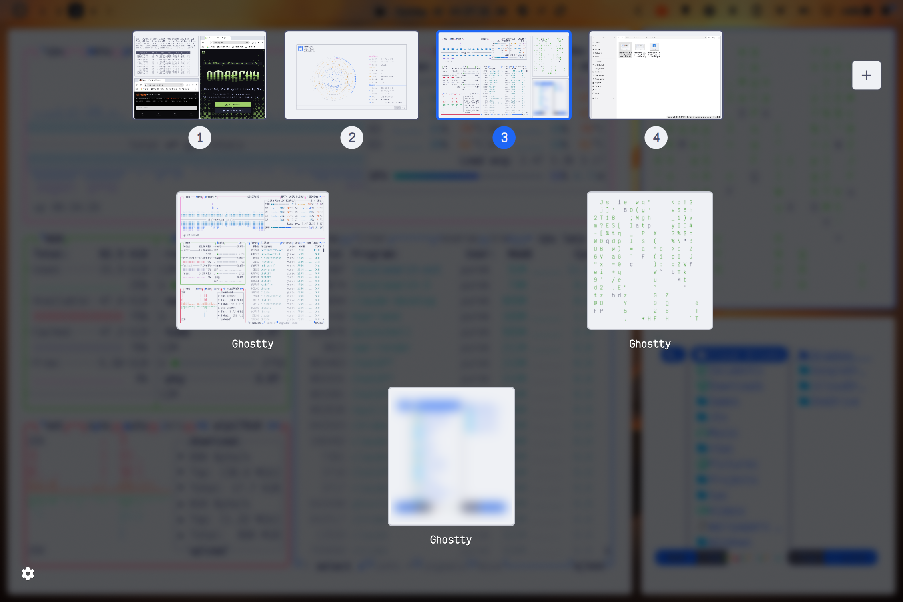

# Omarchy Mission Control

A Mac-style Mission Control for [Omarchy](https://omarchy.org): see every
workspace at a glance, with live pictures of its windows, and move, swap and
arrange them with the mouse or the touchpad.



It is a plugin for omarchy-shell (Omarchy 4 and later). Nothing is compiled
against Hyprland, so Omarchy and Hyprland updates don't break it.

## What it does

- **A row of workspace cards** along the top, one for every workspace from 1
  to the highest one in use, each with live pictures of its windows where they
  sit on the screen.
- **The windows of the workspace you're on**, large, below the row.
- **One click on a card** switches to that workspace and keeps Mission Control
  open; a **double click** switches and closes it.
- **Drag a window** onto another card (or the **+** button) to move it there,
  or onto another window of the same workspace to swap the two. The other
  window slides out of the way before you drop.
- **Drag a card by its number** to reorder workspaces. The **x** on a card
  removes that workspace (its windows join the one before it; nothing is
  closed). The **x** on a large window closes that window.
- **+** adds an empty workspace.
- **Scrolling:** over the cards, the mouse wheel or a three/four-finger swipe
  scrolls the row (with a spring at both ends); anywhere else they switch
  workspace.
- **Follows your theme**, including after a theme change.
- **Settings** (the gear, bottom left): app launcher icon, bar button, smooth
  swipes, About, and Remove Plugin.

## Install

```bash
omarchy plugin add https://github.com/yurekvigo/Omarchy-Mission-Control.git --enable
```

Like every omarchy-shell plugin, it runs as ordinary code inside your shell.
Read it before you enable it.

## Open and close

| | |
|---|---|
| Open | four-finger swipe **up**, **Super + D**, the bar button, or "Mission Control" in the app launcher |
| Close | four-finger swipe **down**, **Esc**, or **Super + D** again |

The plugin registers the shortcut and the swipes with Hyprland while it is
switched on. It never edits your Hyprland config, and switching the plugin off
gives you your own shortcuts back.

While Mission Control is open it uses the three- and four-finger left/right
swipes (whatever they normally do on your computer); when it closes, Hyprland
reloads its config, so yours come back exactly as configured.

### Changing the shortcut or the swipes

Edit `~/.config/omarchy-mission-control/settings.json`, then run
`omarchy restart shell`:

```json
{
  "shortcut": "SUPER + D",
  "gestures": true
}
```

Use `"shortcut": ""` for no keyboard shortcut and `"gestures": false` to leave
the four-finger up/down swipes alone. You can always bind your own key to:

```bash
omarchy-shell io.github.yurekvigo.mission-control toggle
```

## Smooth swipes (optional)

Hyprland keeps three- and four-finger swipe movement to itself, so out of the
box a swipe over the cards moves the row in steps. Switch on **Settings →
Smooth Swipes** and the row follows your fingers instead.

That installs a small system service (it asks for your password):

- It needs `libinput-tools`, an official Arch package.
- It reads the touchpad **only while Mission Control is open**, keeps only
  swipes made with three or more fingers, and passes on nothing but "started,
  moved this far, ended". Key presses are never read out or passed on.
- It is locked down with systemd (no access to your files, read-only system,
  no extra privileges).

Switching Smooth Swipes off removes the service and the package again (if this
plugin installed it).

## Remove

**Settings → Remove Plugin** removes the plugin and everything it set up: the
launcher entry, its settings, and the swipe helper if you installed it.

## Documentation

- [User guide](docs/user-guide.md): everything it does and how, settings,
  troubleshooting.
- [How it works](docs/how-it-works.md): for reading or changing the code.
- [Changelog](CHANGELOG.md)

## Requirements

- Omarchy 4 or later (omarchy-shell, Hyprland with the Lua config)
- A Nerd Font (Omarchy ships one) for the gear symbol

## Credits

Built by **Yurek Vigo** (idea, design, and every "not quite, try again") and
**Claude**, Anthropic's AI (the code, one change at a time).

"Mission Control" is the name of a macOS feature; this project is not
affiliated with or endorsed by Apple. It is not an official Omarchy project.

## Licence

[MIT](LICENSE)
